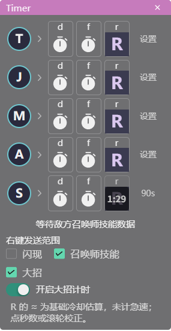
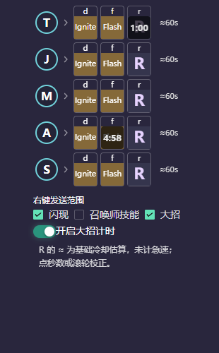

# League Akari Timer

**英雄联盟敌方召唤师技能、大招计时与游戏内快捷报时。**

基于 [LeagueAkari/LeagueAkari](https://github.com/LeagueAkari/LeagueAkari) 的 Windows 计时器改版，由 [Spelight](https://github.com/Spelight) 维护。开局读取敌方技能，手动点击记录施放时间，再把预计转好时间发到队伍聊天。

这是一个已有开源项目上的功能扩展作品。Electron 应用框架、LCU 接入、原生输入模块和其他客户端功能来自上游；本 fork 主要实现计时器的数据接入、排序、时间换算、鼠标交互及批量报时。实现过程使用了 AI 编程辅助。

[下载 Windows 预览版](https://github.com/Spelight/league-akari-timer/releases) · [实现说明](docs/timer/implementation.md) · [验证与限制](docs/timer/validation.md) · [上游 README](docs/UPSTREAM_README.md)

<p>
  
  
</p>

左图是运行包的实际技能窗口；右图是使用模拟数据和占位技能图标的组件演示，用于展示基础冷却估算、倒计时和发送范围设置。

## 功能

| 操作 / 场景            | 行为                                                     |
| ---------------------- | -------------------------------------------------------- |
| 进入对局               | 读取敌方召唤师技能，按 top / jug / mid / ad / sup 排序   |
| 位置标记               | 五个圆圈显示 T / J / M / A / S，点击可手动修正或交换位置 |
| 左键技能               | 开始倒计时；运行中再次点击取消；结束后可重新开始         |
| 滚轮                   | 调整时间，保留反转调整方向设置                           |
| 右键双击技能           | 仅在该类别已勾选时显示并发送该技能的报时                 |
| 计时器内容区域右键三击 | 汇总发送勾选范围内仍在冷却的技能，按位置、D/F/R 顺序排列 |
| 游戏时间可用           | 报预计转好时刻，例如 `ad f 2000`                         |
| 游戏时间不可用         | 报剩余时间，例如 `sup f 3:43`                            |

每行可开启 **R 大招计时器**（显示对应英雄大招图标）：根据对方英雄从当前客户端读取 R 各等级的基础冷却；普通三级大招按英雄 6 / 11 / 16 级估算 R 等级，并以 `≈` 标记。点击 R 开始 / 取消；点击右侧秒数可选择 R 等级、手动秒数或恢复自动，未计时时滚轮每次调整 5 秒。预设只影响下次启动，不修改正在运行的计时。

「开启大招计时」开关可在计时器下方或主窗口设置中切换。关闭会隐藏 R、清除当前大招计时，并从报时中排除大招；D/F 不受影响。开关和发送范围均记住上次选择。

**右键发送范围**可在计时器下方或「设置 → 多窗口 → 计时器」中修改并保存：闪现、召唤师技能、大招，支持组合。召唤师技能包含 D/F（包括闪现），组合勾选不重复发送；默认只勾选闪现，全部取消则不发送。

例如在游戏时间 **15:00** 点击 AD 的 F 槽闪现，按 300 秒基础冷却计算，发送 `ad f 2000`，表示 **20:00** 转好。D/F 表示接口返回的两个技能槽位，闪现不固定在 F。

批量消息示例：

```text
top r 1630 / ad f 2030 / sup d 1810
```

## 下载与使用

1. 从 [Releases](https://github.com/Spelight/league-akari-timer/releases) 下载 Windows x64 ZIP，完整解压后运行 `LeagueAkari.exe`，保留同目录的依赖文件。
2. 此预览包请求管理员权限，用于上游 Windows 原生输入功能。
3. 在计时器设置中启用窗口、选择倒计时模式，并设置显示快捷键和右键发送范围。
4. 进入对局，等敌方技能载入后点击技能开始记录。大招可直接使用标有 `≈` 的基础冷却估算；数据不足或特殊等级的大招需先选择冷却。
5. 报时时保持游戏在前台、聊天输入框关闭。连续右键每次间隔小于 400 ms；双击等待约 0.4 秒，以便区分三击。

预览包未做发布者代码签名。它会使用 League Akari 的应用设置；已有用户请先退出其他版本再启动。

## 实现重点

- **LCU + Live Client 数据**：读取对方阵容与技能，用实时接口补充位置和游戏时钟；暂时断开时保留已识别阵容。
- **游戏时间与本地时间**：优先使用采样的游戏时钟处理暂停；读不到游戏时间时回退到本地剩余时间。
- **倒计时状态**：共用冷却、计时模式和消息格式逻辑，过滤已取消或结束的批量记录。
- **悬浮窗交互**：左键使用指针释放事件并捕获按下位置，减少对合成 click 事件的依赖；双右键和三右键共用判定，避免重复发送。
- **复用原生报时**：沿用上游的前台检查与键盘输入能力，补充发送互斥和错误反馈。

## 本地开发

项目沿用上游的 **Electron + Vue 3 + TypeScript + Pinia / MobX** 架构，使用 Node.js 24 与 Yarn 4。Windows 原生插件构建还需要 Python、MSVC C++ Build Tools 和 Windows SDK。

```powershell
corepack enable
yarn install --immutable
yarn dev
```

检查与打包：

```powershell
yarn typecheck
yarn test
yarn build:timer:win
```

`build:timer:win` 先编译 Windows 原生插件，再构建应用，输出免安装目录 `dist/timer/win-unpacked`。本 fork 的构建参数位于 [electron-builder.timer.cjs](electron-builder.timer.cjs)。

## 当前状态与边界

- 这是**手动施放时间记录器**，不自动判断敌方是否已经使用技能，也不读取敌方真实剩余冷却。
- 大招自动值是基础冷却估算，不是对方实际技能等级或剩余冷却，不包含技能急速 / 大招急速 / 特殊模式修正。非普通三级大招不自动套用 6 / 11 / 16 级规则；可手动选择等级和秒数。手动校正每局重置。
- 不自动计算星界洞悉、装备急速或所有特殊技能形态；需要时用滚轮校正。特殊模式和进化技能尚未全面验证。
- 已通过时间换算与接口轮询单元测试、组件交互回归、Windows 打包启动检查，并用现场对局数据验证了技能载入及程序触发的计时。
- 游戏前台真实鼠标点击失效的全部触发条件尚未确认；当前版本已调整事件处理，仍以**预览版**发布。自动化检查不等同于完整实战验收，真实队伍聊天发送也未做公开发布验收。
- 不把其他上游功能或所有地区、游戏版本的兼容性作为本 fork 的保证。

更多复现步骤、已通过项目和待验证场景见 [验证记录](docs/timer/validation.md)。问题请提交到 [本 fork 的 Issues](https://github.com/Spelight/league-akari-timer/issues)，附应用版本、游戏模式与复现步骤，不要上传登录令牌或完整个人日志。

## 来源与许可

上游项目：[LeagueAkari/LeagueAkari](https://github.com/LeagueAkari/LeagueAkari)。本次修改基于提交 [`4f8981f`](https://github.com/LeagueAkari/LeagueAkari/commit/4f8981f84ff820cc52d85cff937d82d181804cab)，保留上游提交历史、署名与 [MIT License](LICENSE)。完整上游介绍和致谢见 [上游 README](docs/UPSTREAM_README.md)。

本项目不是 Riot Games 官方产品，也未获得其背书；游戏名称及素材属于各自权利人。
