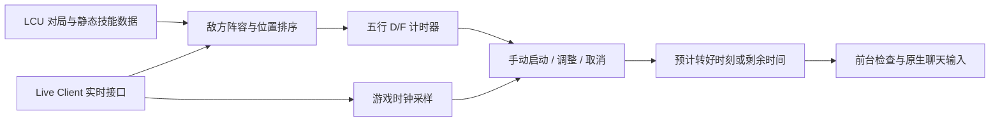

# 计时器实现说明

## 改动范围

本 fork 在 League Akari 已有计时器和原生输入能力上开发；没有重新实现整个客户端工具。

| 层级     | 主要文件                                                                | 职责                                                   |
| -------- | ----------------------------------------------------------------------- | ------------------------------------------------------ |
| 纯逻辑   | `src/shared/cd-timer/index.ts`                                          | 位置排序、技能识别、冷却回退、时钟换算、单条与批量消息 |
| 主进程   | `src/main/shards/window-manager/cd-timer-window/live-data-loader.ts`    | 实时数据轮询、请求超时、停止后的迟到响应隔离           |
| 窗口     | `src/main/shards/window-manager/cd-timer-window/windows.ts`             | 对局期间启动加载、状态同步、悬浮窗口、原生发送         |
| 渲染状态 | `src/renderer-shared/shards/window-manager/store.ts`                    | 接收实时对局快照                                       |
| 组件     | `src/renderer/src-cd-timer-window/components/SummonerSpellsCdTimer.vue` | 敌方行、手动位置修正、计时器管理、消息反馈             |
| 单行控件 | `src/renderer/src-cd-timer-window/components/TimerItem.vue`             | T/J/M/A/S、D/F、倒计时显示、左键与滚轮                 |
| 手势     | `src/renderer/src-cd-timer-window/composables/useRightClick.ts`         | 双右键 / 三右键竞争及生命周期清理                      |

## 数据与时钟

通过现有 GameClient API 读取 `/liveclientdata/allgamedata`。每次请求结束后等待 500 ms 再发起下一次，请求超时为 2 秒；窗口功能关闭或离开对局时停止。`activePlayer` 用来识别己方队伍，再选择敌方五人。

技能冷却优先采用客户端提供的有效数值；缺失时使用常见技能的基础值。读取到的 D/F 顺序直接保留。位置优先取实时数据，LCU 作为补充；识别不足时允许手动选择，不只按数组顺序猜位置。

计时器同时保留游戏时间基准和本地时间戳。2.5 秒以内的游戏时钟样本可用于显示与报时；采样时钟不额外按墙钟外推，以免暂停时继续前进。接口暂时失效时使用本地剩余时间，恢复后重新对齐。

## 交互与报时

左键按下时捕获指针，释放时触发技能操作。倒计时遮罩和点击反馈层设为 `pointer-events: none`，不截获鼠标命中。Enter 和空格保留键盘触发。

窗口统一接收右键释放事件。400 ms 内同一技能连续两次右键触发单条报时；第三次右键优先触发汇总并取消待发送的单条。非右键操作、窗口失焦和对局清理都会取消待处理的手势。空白内容区域也参与三击汇总。

有游戏时钟时将转好时间向上取整为秒，并格式化为 `mmss`；无时钟时发送 `m:ss` 的剩余时间。汇总按 top / jug / mid / ad / sup 与 D/F 排序，只包括正在冷却的计时器。

主进程复用上游 `nativeInput`：检查游戏前台，发送 Enter、文字、Enter。互斥标记避免同时发送多条；失败原因回传到界面。本功能不自动加入游戏、不调用外部聊天服务。

## 版本构建

预览版本：`1.5.2-beta.timer.20261118.3`。本 fork 的 `electron-builder.timer.cjs` 继承上游打包配置，添加 Windows 管理员清单、固定预览版本和独立输出目录；不提交个人设置、日志或本机工具路径。

修改作者：Spelight，使用 AI 编程辅助。应用框架、原生模块、LCU 和其他未修改功能继续归属上游贡献者。
